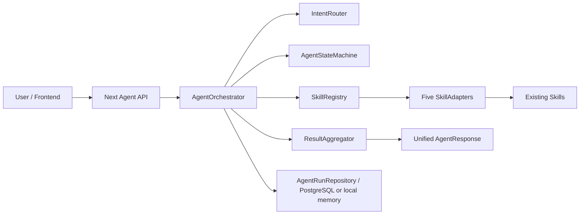

# Deterministic Agent framework

## 实际审核与范围

技术栈保持 Next.js 16 / TypeScript + ESM / npm / Zod / postgres。业务金融数据继续使用现有明确标注的 synthetic demo Repository；没有接通真实银行或购物平台。

审核后按五个业务 Skill 注册。`commerce/commerce-client.mjs` 是 HTTP 依赖客户端；`scenario/purchase-skill.mjs` 是 scenario 下已有购物子工作流，本轮不另建购物执行链。`src/skill/transfer/index.ts` 明确 deprecated，不接入该平行实现。

| Registry 名称 / Adapter | 已有生产入口 | 统一 arguments → 现有输入 | 现有输出 → SkillResult.data |
|---|---|---|---|
| bill / BillAdapter | `src/agent/runtime.mjs: handleBillSummary, handleSubscriptionList`，摘要复用 `src/skills/bill/bill-summary.mjs: summarizeBills` | `action=bill.summary, month` → `intent.slots.month`；或 `subscription.list` | 原 data；kind/evidence 放 metadata |
| card / CardAdapter | `src/agent/handlers/card-handler.mjs: handleCard` → `src/skills/card/card-skill.mjs: resolveCardReference, runResolvedCardIntent` | action/card_ref/amount → action/slots；原解析器生成实体引用 | 原查询或 action_request；不执行卡片修改 |
| wealth / WealthAdapter | `src/skills/wealth/wealth-skill.mjs: createWealthSkill(repository)` | 原扁平 action 参数；compare/recommend/assess_risk | 原 data；保留模拟来源/证据 |
| scenario / ScenarioAdapter | `src/skills/scenario/scenario-skill.mjs: createScenarioSkill` | 原 create_rule / review_event 参数 | 规则提案或事件复核；不是规则提交回执 |
| transfer / TransferAdapter | `src/agent/runtime.mjs: handleTransfer, transferRepository` | 外部转账 action/source_account_ref/payee_ref/amount → intent.slots | transfer_resolution；不是支付回执 |

以上执行入口均异步；校验同步。bill 可能抛异常；其余可能返回 `ok:false/error` 或 `needs_clarification`。Adapter 安全转换异常，不返回内部异常消息；缺参进入 COLLECTING_INPUT，不补金融默认值。未列入 schema 的动作（含购物、理财申购赎回、本人账户互转）继续使用原业务 API，本轮统一入口拒绝调用。

## 架构



`server/agent-framework/` 分离模型、路由、编排、状态机、注册、Adapter、聚合、Repository、HTTP 和装配。仅 adapters.mjs 引入 Skill 生产实现；Orchestrator 不知道五个 Skill 的内部逻辑。现有 `/api/banking-agent`、Planner、Core 和 UI 不改写；本接口补充确定性结构化任务生命周期，不替代既有自然语言或金融执行链。

## API

| 方法 | 路径 | 用途 |
|---|---|---|
| POST | `/api/v1/agent/runs` | 创建、执行；必需 Idempotency-Key |
| GET | `/api/v1/agent/runs/{run_id}` | 状态、计划、当前步骤、结果、版本 |
| POST | `/api/v1/agent/runs/{run_id}/input` | 补参，同一 run 继续 |
| POST | `/api/v1/agent/runs/{run_id}/confirm` | 匹配具体步骤的确认 |
| POST | `/api/v1/agent/runs/{run_id}/cancel` | 取消；在途调用返回 202，停止后续步骤 |
| GET | `/api/v1/skills` | 五个 Skill 元数据 |
| GET | `/api/v1/skills/{skill_name}/schema` | Zod 生成的输入/输出 JSON Schema |
| GET | `/health` | 进程存活，不初始化数据库 |
| GET | `/ready` | Repository 和五个 Adapter 可调用性 |

除 health 外复用现有演示访问码语义：`X-Saveflow-Access` 必须匹配服务端 `SAVEFLOW_ACCESS_CODE`（至少 16 字符），校验同源；客户端不能指定 user_id。当前仍为私有单模拟用户，不是生产多租户鉴权。请求体最多 16KB。错误使用 401/403/404/409/422/500/502/503/504，不全部包装 HTTP 200。

统一 envelope：`{request_id,run_id,state,data,error}`。SkillResult：`{status,data,user_message,error,retryable,metadata,audit}`。输出、日志和审计不返回密钥及完整账号；原始凭证/长账号不能作为参数传入。状态日志只记录状态、版本、run_id 和时间。

## 状态机

| 原状态 | 允许目标 |
|---|---|
| CREATED | UNDERSTANDING, CANCELLED |
| UNDERSTANDING | COLLECTING_INPUT, PLANNING, FAILED, CANCELLED |
| COLLECTING_INPUT | PLANNING, CANCELLED |
| PLANNING | READY_TO_EXECUTE, COLLECTING_INPUT, FAILED, CANCELLED |
| READY_TO_EXECUTE | WAITING_CONFIRMATION, EXECUTING, CANCELLED |
| WAITING_CONFIRMATION | EXECUTING, CANCELLED |
| EXECUTING | AGGREGATING, COLLECTING_INPUT, FAILED, CANCELLED |
| AGGREGATING | SUCCEEDED, FAILED, CANCELLED |
| SUCCEEDED / FAILED / CANCELLED | 无，终态 |

每次状态变化生成 AuditEvent 与结构化日志；存储使用 version CAS，修改操作先占用 busy 标记。Router 只有结构化建议，无状态修改权限。规则路由仅识别少量明确查询，可直接提交 skill_name/arguments 或 steps；低置信度收集输入。

## 确认、计划和幂等

默认顺序执行，每步包含 step_id/skill_name/arguments/dependencies/mappings/status/result/error。依赖只能引用前序步骤，拒绝重复 ID、未知 Skill、无效映射。映射只复制明确命名的标量字段，禁止整个对象传递；失败或 partial 立即停止，不能聚合为成功。

READ_ONLY 跳过确认；card 操作提案为 WRITE，scenario（事件复核可记录 review）保守归 WRITE，transfer 为 SENSITIVE_WRITE。确认仅授权本次 Adapter 调用；不代替原 Banking Core 的金融预览、验证码、确认和执行授权。

确认必须提交返回的 run_id、step_id、operation_type、operation_summary、arguments_digest、idempotency_key 以及 `confirmed:true`。每个写步骤独立确认；参数摘要改变即拒绝旧确认。WAITING_CONFIRMATION 不接受补参，修改需取消后新建任务。禁止将“好的”等聊天文字作为确认。

创建幂等键按用户隔离，同键同参返回已有 run，同键不同参为 DUPLICATE_REQUEST。步骤键绑定 run/step/参数摘要；调用前持久化 started，结果和尝试次数随后持久化。默认最多 1 次重试，配置限制 0–3；仅明确可重试的只读错误允许重试。超时和写操作不自动重试。超时标明 outcome_unknown，不宣称底层动作已停止。

## 示例

创建只读任务（月份为用户明确输入，不是填充的默认值）：

```json
{"session_id":"demo_session","query":"查看2026-09账单","skill_name":"bill","arguments":{"action":"bill.summary","month":"2026-09"}}
```

不提供 month 时返回 COLLECTING_INPUT，`data.missing_fields=["step_1.month"]`。向 `/input` 提交 `{"arguments":{"month":"2026-09"}}`。

多步骤显式映射示例：先查询一个月账单，再复用该结果中的 month 查询。实际两业务 Skill 的 bill→card 顺序示例见 `scripts/verify-agent-framework.mjs`。

```json
{"session_id":"demo_session","query":"顺序查询","steps":[{"step_id":"a","skill_name":"bill","arguments":{"action":"bill.summary","month":"2026-09"}},{"step_id":"b","skill_name":"bill","arguments":{"action":"bill.summary"},"dependencies":["a"],"mappings":[{"from_step":"a","from_field":"month","to_field":"month"}]}]}
```

响应字段示意（占位符不是实际执行结果）：

```json
{"request_id":"<request UUID>","run_id":"<run UUID>","state":"COLLECTING_INPUT","data":{"current_step":null,"result":null,"missing_fields":["step_1.month"],"confirmations":[],"version":3,"busy":false},"error":null}
```

## 启动与验证

在 `Github-demo/saveflow-demo` 目录运行。使用现有 `.env.local` 配置服务端访问码；无需配置 LLM 密钥。若使用 PostgreSQL，设置 DATABASE_URL 后运行原迁移命令。

```powershell
# 本机 Node 不在默认 PATH 时：
$env:Path = 'C:/Users/25123/AppData/Local/Programs/node-v22.23.3-win-x64;' + $env:Path
npm.cmd run db:migrate # 仅在已配置 DATABASE_URL 时需要
npm.cmd run dev
# 另一个终端，替换为自己的服务端访问码，不提交到仓库：
Invoke-RestMethod http://localhost:3000/health
Invoke-RestMethod http://localhost:3000/ready -Headers @{'X-Saveflow-Access'=$env:SAVEFLOW_ACCESS_CODE}
npm.cmd run test:agent-framework
npm.cmd test
node scripts/verify-agent-framework.mjs
node node_modules/typescript/bin/tsc --noEmit --incremental false
```

受限环境无法创建测试子进程时，新测试可用：
`node --test --experimental-test-isolation=none tests/agent-framework.test.mjs tests/agent-framework-postgres.test.mjs`。

## 持久化和真实边界

`008_agent_runs.sql` 与既有 PostgreSQL 依赖/迁移入口集成，保存 run、计划、步骤、确认、审计及执行幂等记录。新增取消字段独立更新，不覆盖执行状态。未配置 DATABASE_URL 时使用明确的本地 InMemoryAgentRunRepository；生产默认拒绝内存模式，除非显式 ALLOW_EPHEMERAL_BANKING=true。

HTTP 冒烟脚本强制关闭数据库连接、生成随机测试访问码，只使用原仓库 synthetic 数据。超时、重试、写操作执行次数、字段映射测试使用明确 Mock Adapter；真实五个 Adapter 测试调用的是原 Skill 与原模拟 Repository，不代表已连接真实银行。未创建外部接口或密钥。

## 已知限制与验收记录

- 本轮交付确定性调用与操作提案，未扩展金融执行权限；实际资金和卡片写操作仍须原 Core 流程。
- schema 只开放表中明确动作；未覆盖所有已有 Skill 子功能。动态输出映射到写步骤暂拒绝，避免确认尚未确定的参数。
- 内存不跨进程、不持久；生产多租户鉴权、审计保留期限与数据加密策略仍须部署方完善。
- 进程在调用后、记录结果前崩溃时保留 busy/started，不自动重放；人工对账和可靠后台恢复尚未实现。
- 取消是协作式的：不撤销已完成步骤，不保证中断不支持 AbortSignal 的既有 Skill。超时同样不等于底层动作取消。
- 默认 scenario store 无伪造可信事件；review_event 在未接入可信事件源时失败。规则创建仅返回提案。
- 未配置 BANKING_TEST_DATABASE_URL，新增 PostgreSQL 集成测试跳过；真实银行、LLM 和购物外部服务均未联调。
- 修改前快照 `0328738` 与工作树原有测试均实际得到 **653 通过 / 13 失败 / 14 跳过**，失败名称一致。已有失败包括产品列表断言与现有 seed 不符、旧 wealth 集成、缺失 react-test-renderer。未为凑通过数修改既有测试或业务规则；因此“原有测试全部通过”验收项尚未满足。
- 新增单元/集成套件最近已执行 **32 通过 / 0 失败 / 1 PostgreSQL 跳过**。类型检查和本次文件 lint 已执行通过。
- 实际 Next HTTP 冒烟已执行 **8 通过 / 0 失败**，覆盖健康检查、五个 Skill/schema、单查询、补参、确认提案、重复创建、取消和两 Skill 顺序查询。超时与重试通过 Mock Adapter 单元/API 测试验证。
